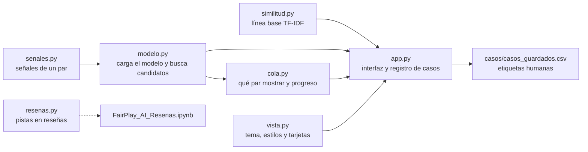

# App FairPlay AI: similitud entre videojuegos

App web en Gradio. Esta carpeta tiene el código de la app y la lógica que comparte con los notebooks.

> ¿Solo quieres probarla o etiquetar pares? No instales nada: lee [LEEME_PROBADORES.md](LEEME_PROBADORES.md).

| Pestaña | Qué hace | Necesita el modelo |
|---|---|---|
| **Etiquetar pares** | La cola de revisión: un par, un clic, el siguiente. Con saltar y deshacer. | Sí |
| **Buscar un juego** | Candidatos del modelo para un juego, con la **probabilidad de que el par merezca revisión humana**, la explicación de cada señal y las imágenes lado a lado. Un selector permite ordenar con el Modelo B (por defecto) o el A. | Sí |
| **Comparar dos juegos** | Un par concreto, lado a lado, con la probabilidad de cada modelo y la explicación del elegido. | Sí |
| **Línea base (solo palabras)** | TF-IDF: buscar similares, comparar dos juegos y texto nuevo, con las palabras que explican el parecido. | No |
| **Ayuda** | Cómo usar la app y qué significa cada etiqueta. | No |

El modelo es el que entrena el notebook `FairPlay_AI_Clasificador_Pares.ipynb` (texto, imágenes, título,
tags y fechas). Los casos que se etiquetan en cualquier pestaña son las **etiquetas humanas** con que se
entrena y evalúa ese modelo.



## Archivos

- `similitud.py`: la lógica (carga de datos, TF-IDF, búsqueda, comparación). No depende de Gradio.
- `senales.py`: calcula las señales de un par de juegos, igual que el notebook. Sin interfaz ni GPU.
- `modelo.py`: carga el paquete del modelo exportado por el notebook, busca candidatos y explica pares. Los candidatos salen del texto (palabras y significado) más los juegos con una imagen casi idéntica (coseno CLIP ≥ 0,96, constante `UMBRAL_IMAGEN_IDENTICA`).
- `app.py`: la interfaz y el registro de casos. Arriba se escribe el nombre de quien etiqueta (el navegador lo recuerda). Pestañas: **Etiquetar pares** (la cola: un par, un clic, el siguiente; con saltar y deshacer), **Buscar un juego** (candidatos del modelo, con explicación y veredicto), **Comparar dos juegos** (un par concreto, lado a lado, con la opinión del modelo), **Línea base** (buscar similares, comparar y texto nuevo, solo con palabras) y **Ayuda**.
- `vista.py`: la capa visual (tema, CSS, tarjetas de candidatos y barras de la explicación).
- `cola.py`: la **cola de revisión**. Decide qué par mostrar a cada persona (sin repetir los ya etiquetados) y cuenta el progreso: pares por persona (meta: 30) y lo que le falta al equipo para entrenar el Modelo B (10 «Posible copia» y 10 «Similar» o «No similar»).
- `resenas.py`: busca en las reseñas de Steam expresiones como *"a clone of X"* para proponer pares que etiquetar. Lo usa el notebook `FairPlay_AI_Resenas.ipynb`, no la app. Es una pista para priorizar, no una señal del modelo.
- `LEEME_PROBADORES.md`: guía corta para quien prueba la app publicada.
- `requirements.txt`: dependencias con versiones fijas, probadas con Python 3.12.
- `environment.yml`: el mismo entorno para Conda.

## Requisitos

Python 3.12 (también funciona con 3.11):

```bash
pip install -r requirements.txt
```

## Uso

Pon el parquet en `data/juegos_texto_en.parquet` (dentro de esta carpeta). Debe tener, como
mínimo, las columnas `name` (título) y `text` (descripción ya limpia). Si existen, también usa
`genres`, `release date`, `appid` y `n_resenas`. Los nombres van en minúscula.

```bash
python app.py                        # abre en http://127.0.0.1:7860
python app.py --share                # además crea un enlace público temporal
python app.py --datos otra/ruta.parquet
```

### Activar las pestañas del modelo

1. Corre el notebook `FairPlay_AI_Clasificador_Pares.ipynb` hasta la sección 11 ("Exportar el paquete del modelo").
2. Copia la carpeta `salidas/paquete_app` a esta carpeta con el nombre `modelo/`. Debe quedar así:

   ```plaintext
   Primera fase práctica/modelo/
   ├── modelo_pares.joblib
   ├── catalogo.parquet
   ├── emb_texto.npy
   └── imagenes.joblib
   ```

3. Abre la app. Si la carpeta no está, aparecen **Línea base**, **Ayuda** y una pestaña que explica cómo generarla.
   Para usar otra carpeta: `python app.py --modelo otra/carpeta`.

Estas pestañas no necesitan GPU ni descargar modelos de IA: todo lo pesado ya se calculó en el notebook.
Por eso solo buscan juegos que estén en el catálogo del modelo. La carpeta `modelo/` contiene datos de
Steam y no se sube al repositorio (está en `.gitignore`).

La primera ejecución ajusta el TF-IDF y guarda una caché junto al parquet
(`juegos_texto_en.tfidf.joblib`). Las siguientes arrancan casi al instante.
Si cambias el parquet, la caché se regenera sola.

### Variables de entorno (opcionales)

Permiten configurar la app sin cambiar el código. Son las que usa Hugging Face Spaces.

| Variable | Para qué |
|---|---|
| `FAIRPLAY_DATOS` | Ruta del parquet (reemplaza a `--datos`). |
| `FAIRPLAY_MODELO` | Carpeta del modelo entrenado (reemplaza a `--modelo`). Por defecto `modelo`. |
| `FAIRPLAY_HF_DATASET` | Si el parquet o el modelo no están en disco, se descargan de este dataset de Hugging Face (por ejemplo `usuario/fairplay-datos`). Puede ser privado. |
| `HF_TOKEN` | Token de lectura de Hugging Face, necesario si el dataset es privado. |
| `GRADIO_SERVER_NAME` | Dirección donde escucha la app. Por defecto `127.0.0.1` (solo tu computador). Spaces usa `0.0.0.0`. |
| `GRADIO_SERVER_PORT` | Puerto. Por defecto `7860`. |
| `FAIRPLAY_CLAVE` | Si está definida, la app pide usuario y contraseña (útil al publicarla en un servidor). |
| `FAIRPLAY_USUARIO` | Usuario para entrar cuando hay `FAIRPLAY_CLAVE`. Por defecto `fairplay`. |

## Publicar la demo

**Versión permanente:** la app está publicada en una VM gratuita de Oracle Cloud, con HTTPS y contraseña del equipo. Los pasos y la mantención están en [`despliegue/oci/README.md`](../despliegue/oci/README.md).

Para una demo rápida sin servidor: Hugging Face Spaces con Gradio ahora requiere la suscripción PRO, así que la demo se comparte con un **enlace temporal de Gradio**:

* **Colab (recomendado):** abrir `FairPlay_AI_Demo.ipynb` y *Ejecutar todo*.
* **Windows:** `.\demo.ps1` en esta carpeta (si Windows Defender bloquea `frpc`, usar Colab).

Detalles, y cómo usar un Space si el equipo contrata PRO, en la [Guía técnica](../docs/GUIA_TECNICA.md#8-publicar-la-demo).

## Casos guardados

Cada caso marcado en la app se agrega a `casos/casos_guardados.csv`, con fecha, anotador,
tipo, consulta, juego comparado, puntaje, etiqueta (Similar, No similar o Posible copia) y comentario.
El **tipo** dice de dónde salió el par: `cola-modelo`, `cola-texto` o `cola-bajo` (pestaña *Etiquetar pares*),
`comparar-modelo` (pestaña *Comparar dos juegos*), etc. Si una persona etiqueta dos veces el mismo par, vale la última.
Se abre bien en Excel y en pandas (`encoding="utf-8-sig"`).

Para usarlos en el notebook principal, copia ese archivo a `data/casos_guardados.csv` en la carpeta
del notebook (o en `MyDrive/fairplay/data/` si usas Google Drive). Ahí se traducen así:
*Posible copia* → 1, *Similar* y *No similar* → 0.

## Tests

Desde la raíz del repositorio:

```bash
pip install -r requirements-dev.txt
pytest
```

## Importante

- Los datos de Steam no se deben publicar: no subas `data/`, `casos/` ni `modelo/` a un repositorio abierto. Tampoco el texto de las reseñas.
- Con `--share` cualquiera que tenga el enlace puede usar la app mientras esté corriendo.
- La similitud no es plagio: la app solo sugiere candidatos para revisión humana.
