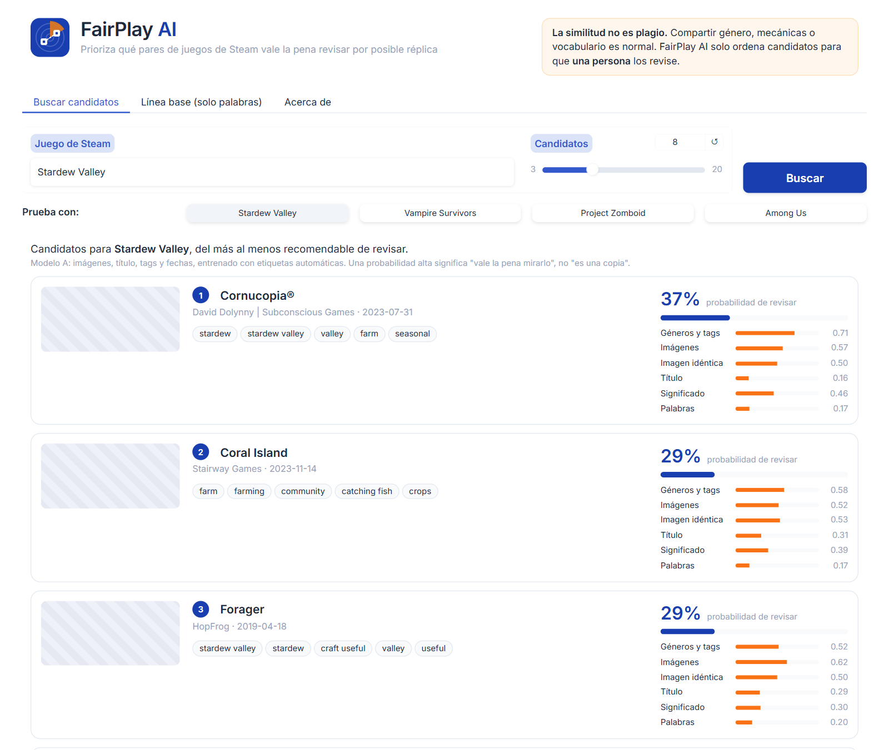
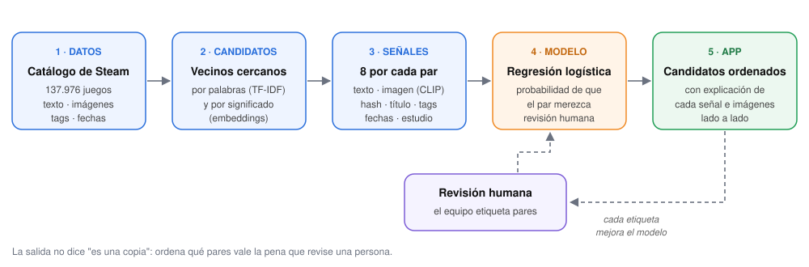
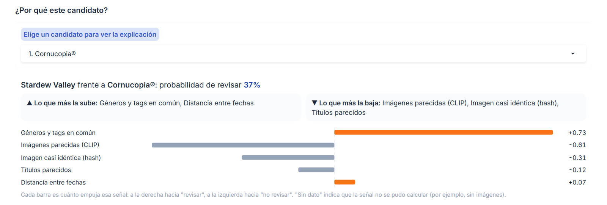
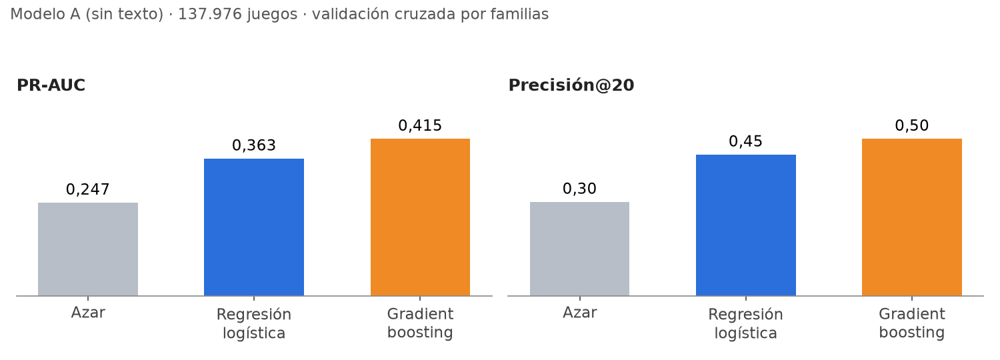
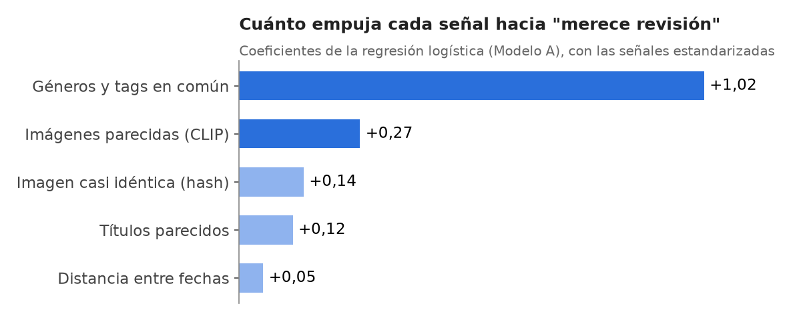

<p align="center">
  
</p>

# FairPlay AI · SIC IA Clone Radar

**Sistema que prioriza qué pares de juegos de Steam vale la pena que revise una persona por posible réplica, combinando su descripción, sus imágenes y sus metadatos.**

Proyecto capstone del **Samsung Innovation Campus 2026 · Inteligencia Artificial**.
Equipo: **Ignacio Hidalgo, Sergio Rebolledo, Catalina Caris y Avelyn García**.

[](https://github.com/sergiorebolledo/sic-ia-clone-radar/actions/workflows/tests.yml)
[](https://colab.research.google.com/github/sergiorebolledo/sic-ia-clone-radar/blob/feat/clasificador-pares/FairPlay_AI_Clasificador_Pares.ipynb)

> ⚠️ **La similitud no es plagio.** Compartir mecánicas, convenciones de género o vocabulario es parte natural de la industria. FairPlay AI **no acusa ni decide**: ordena candidatos y entrega evidencia técnica, reproducible y explicable para que una persona especialista los revise.

<p align="center">
  
  <br><sub>La app buscando candidatos para <i>Stardew Valley</i> con el modelo entrenado. Cada columna es una señal entre 0 (nada parecido) y 1 (idéntico).</sub>
</p>

---

## 📑 Contenido

1. [El problema](#-el-problema)
2. [Qué hace FairPlay AI](#-qué-hace-fairplay-ai)
3. [Cómo funciona](#-cómo-funciona)
4. [Resultados](#-resultados)
5. [Pruébalo](#-pruébalo)
6. [Estructura del repositorio](#-estructura-del-repositorio)
7. [Datos y ética](#-datos-y-ética)
8. [Limitaciones](#-limitaciones)
9. [Estado del proyecto y próximos pasos](#-estado-del-proyecto-y-próximos-pasos)
10. [Antecedente: primer experimento con datos simulados](#-antecedente-primer-experimento-con-datos-simulados)
11. [Documentación](#-documentación)

---

## 🎯 El problema

En Steam se publican miles de juegos al año. Cuando un juego independiente tiene éxito, aparecen réplicas que copian su descripción, su arte o su nombre. Casos conocidos como *Escape the Walls*, *Meccha Chameleon* o *Needle In A Haystack* muestran que el desarrollador afectado suele enterarse tarde y sin pruebas ordenadas.

Revisar el catálogo a mano es imposible (~138 mil juegos), y una búsqueda por palabras se equivoca en las dos direcciones:

* **Falsas alarmas:** dos juegos de granjas usan el mismo vocabulario sin que uno copie al otro.
* **Clones que se escapan:** una réplica puede reescribir la descripción y reutilizar las capturas.

**Pregunta que responde el sistema:** dado un par de juegos, *¿merece una revisión humana?*

---

## 💡 Qué hace FairPlay AI

<p align="center">
  
</p>

1. **Datos:** toma el catálogo público de Steam (137.976 juegos tras la limpieza) con descripción, imágenes, tags, desarrollador y fecha.
2. **Candidatos:** para cada juego busca sus vecinos más cercanos por palabras (TF-IDF) y por significado (embeddings). Así no compara todos contra todos.
3. **Señales:** para cada par calcula 8 medidas de parecido: texto, imágenes, título, tags, fechas y estudio.
4. **Modelo:** una regresión logística combina las señales en una **probabilidad de que el par merezca revisión**.
5. **App:** muestra los candidatos ordenados, el valor de cada señal, las imágenes lado a lado y **por qué** el modelo dio esa probabilidad.
6. **Ciclo humano:** el equipo etiqueta pares en la app o en un Excel, y esas etiquetas entrenan y evalúan el modelo final.

---

## ⚙️ Cómo funciona

### Las señales

Cada una falla en casos distintos; por eso se combinan. Todas valen entre 0 y 1, salvo la distancia entre fechas.

| Señal | Qué pregunta responde | Cómo se calcula |
|---|---|---|
| `tfidf_cos` | ¿Usan **las mismas palabras**? | TF-IDF da más peso a las palabras raras; se mide la similitud coseno. |
| `emb_cos` | ¿Dicen **lo mismo** con otras palabras? | Modelo de lenguaje multilingüe (`paraphrase-multilingual-MiniLM-L12-v2`). |
| `img_cos` | ¿Sus imágenes **se ven parecidas**? | CLIP (`clip-ViT-B-32`) sobre la imagen de cabecera y hasta 3 capturas; se guarda el par más parecido. |
| `phash_sim` | ¿Comparten una imagen **casi idéntica**? | Hash perceptual de 64 bits: detecta capturas reutilizadas aunque cambie el tamaño. |
| `titulo_sim` | ¿Los **nombres** se parecen? | Comparación de las palabras del título, sin importar el orden. |
| `tags_jaccard` | ¿Comparten **géneros y tags**? | Tags en común ÷ tags totales. |
| `log_dias` | ¿Salieron **cerca en el tiempo**? | Logaritmo de los días entre lanzamientos. |
| `mismo_dev` | ¿Son del **mismo estudio**? | Una secuela propia no es un clon. |

### Las etiquetas

Un modelo necesita ejemplos de "sí merece revisión" y "no la merece":

* **Etiquetas débiles (automáticas):** pares de estudios distintos con descripción casi idéntica (`tfidf_cos ≥ 0,90` y `emb_cos ≥ 0,80`) como positivos, y pares del mismo tema con texto distinto como negativos. Hay miles, pero son aproximadas.
* **Etiquetas humanas:** el equipo revisa pares con criterios escritos en la [Guía de etiquetado](docs/GUIA_ETIQUETADO.md). El notebook genera un **lote de 100 pares** en Excel (lista desplegable, enlaces a Steam) y la app permite guardar casos con un clic.

### Dos modelos, para no hacer trampa

| | Modelo A | Modelo B |
|---|---|---|
| **Señales** | Imágenes, título, tags y fechas (**sin texto**) | Todas |
| **Etiquetas** | Débiles | Humanas |
| **Para qué** | Funciona desde el día 1. Como las etiquetas débiles salen del texto, el modelo **no puede ver el texto**: si lo viera, solo aprendería la regla que las creó. Así aprende a reconocer clones aunque la descripción esté reescrita. | Es el modelo final. Se activa solo cuando hay al menos 10 etiquetas humanas de cada clase. |

Ambos son una **regresión logística** (imputación de vacíos → estandarización → regresión), elegida porque es interpretable: el aporte de cada señal se puede mostrar en la app. Se compara con *gradient boosting* como referencia.

### Evaluación sin fugas

* **Validación cruzada por familias** (`GroupKFold`): un juego y sus clones nunca quedan repartidos entre entrenamiento y prueba.
* **Métricas pensadas para revisar pocos casos:** PR-AUC (útil cuando los positivos son pocos) y **precisión@20** (de los 20 pares que el modelo pone arriba, cuántos valían la pena), siempre contra la línea base TF-IDF y el azar.

### Explicación de cada par

La app muestra cuánto empujó cada señal hacia "revisar" o "no revisar", además de las imágenes de ambos juegos lado a lado:

<p align="center">
  
</p>

---

## 📊 Resultados

Corrida completa en Google Colab (GPU T4), 4 de noviembre de 2026, sobre **137.976 juegos** de Steam. Todavía **no hay etiquetas humanas**, así que lo que se mide es el **Modelo A** con validación cruzada sobre 3.000 pares con etiquetas débiles (750 positivos):

<p align="center">
  
</p>

| Modelo | PR-AUC | ROC-AUC | Precisión@20 |
|---|---|---|---|
| Modelo A · regresión logística | 0,363 | 0,664 | 0,45 |
| Modelo A · gradient boosting | 0,415 | 0,722 | 0,50 |
| Azar (referencia) | 0,247 | 0,499 | 0,30 |

**¿Qué señales pesan más?** En la regresión logística, la que más empuja es la coincidencia de géneros y tags, seguida por el parecido de las imágenes:

<p align="center">
  
</p>

**Cómo leer estos números:**

* ✅ **Lo que muestran:** sin mirar el texto, el modelo ordena los pares mejor que el azar (+47 % en PR-AUC, de 6 a 9 aciertos de cada 20 con la regresión logística). Las imágenes aportan información real.
* ⚠️ **Lo que no muestran:** las etiquetas débiles salen del texto, así que esto no mide "detectar copias". La evaluación que vale para el informe es la del **Modelo B con etiquetas humanas** (pendiente: ver [próximos pasos](#-estado-del-proyecto-y-próximos-pasos)).
* 🚫 **Corrida descartada:** una versión anterior dio PR-AUC 0,669, pero estaba inflada: a los negativos les faltaba la imagen mucho más que a los positivos y el modelo aprendió "sin imagen = no es copia". Se corrigió entrenando solo con pares que tienen imagen. **No citar ese número.**

---

## 🚀 Pruébalo

### Opción 1 · Demo pública en Colab (sin instalar nada)

1. Abrir [`FairPlay_AI_Demo.ipynb`](FairPlay_AI_Demo.ipynb) en Google Colab (no necesita GPU).
2. *Entorno de ejecución → Ejecutar todo* y aceptar el acceso a Google Drive.
3. A los ~5 minutos aparece un enlace `https://….gradio.live`: ábrelo y compártelo.

El enlace funciona mientras la pestaña de Colab siga abierta (hasta una semana). Requiere que el paquete del modelo esté en `MyDrive/fairplay/salidas/paquete_app/` (lo crea el notebook principal). Los casos que se marquen en la demo se guardan en Drive y alimentan el entrenamiento.

> Hugging Face Spaces con Gradio ahora exige la suscripción PRO, por eso la demo usa el enlace temporal de Gradio. Alternativas en la [Guía técnica §8](docs/GUIA_TECNICA.md#8-publicar-la-demo).

### Opción 2 · Entrenar el modelo (notebook principal)

1. Abrir [`FairPlay_AI_Clasificador_Pares.ipynb`](FairPlay_AI_Clasificador_Pares.ipynb) en Colab con el botón de arriba.
2. *Entorno de ejecución → Cambiar tipo de entorno → GPU T4*.
3. *Ejecutar todo* y aceptar el acceso a Drive.

Descarga el dataset de Kaggle, calcula embeddings e imágenes (todo queda en caché en Drive), entrena, evalúa, genera el lote para etiquetar y **exporta el paquete** que usa la app. La primera corrida es larga (solo las imágenes de cabecera de todo el catálogo toman unos 45 minutos); las siguientes reutilizan la caché.

### Opción 3 · App en tu computador

```bash
python -m venv .venv
.venv\Scripts\activate            # Mac/Linux: source .venv/bin/activate
pip install -r "Primera fase práctica/requirements.txt"
cd "Primera fase práctica"
python app.py                     # abre http://127.0.0.1:7860
```

Sin más pasos funciona la **línea base TF-IDF**. Para la pestaña **Modelo entrenado**, copia los cuatro archivos de `MyDrive/fairplay/salidas/paquete_app/` a `Primera fase práctica/modelo/`. En Windows, `.\demo.ps1` hace todo esto y además intenta abrir un enlace público. Detalles en el [README de la app](Primera%20fase%20práctica/README.md).

| Pestaña | Para qué sirve |
|---|---|
| **Modelo entrenado** | Candidatos para un juego, ordenados por probabilidad de revisión, con señales, imágenes y explicación. |
| Buscar similares | Línea base: juegos más parecidos por palabras y los términos que comparten. |
| Comparar dos juegos | Línea base: cuánto aporta cada palabra al parecido de dos juegos concretos. |
| Texto nuevo | Línea base: busca a partir de una descripción escrita (en inglés). |

En todas se puede guardar un caso (*Similar*, *No similar*, *Posible copia*) que se suma a las etiquetas humanas.

### Opción 4 · Ayudar a etiquetar

Sigue la [Guía de etiquetado](docs/GUIA_ETIQUETADO.md): copia `salidas/lote_para_etiquetar.xlsx` a `MyDrive/fairplay/data/lote_etiquetado.xlsx`, complétalo con la lista desplegable y vuelve a correr el notebook.

### Tests

```bash
pip install -r requirements-dev.txt
pytest
```

38 tests comprueban la línea base (el clon queda primero, puntajes simétricos, caché), las señales por par (imágenes idénticas, datos faltantes), el modelo entrenado (candidatos ordenados, explicación legible, versión de scikit-learn incompatible) y la app (guardar casos, construir la interfaz con y sin modelo, descargar desde Hugging Face). Se corren solos en GitHub Actions en cada push.

---

## 📂 Estructura del repositorio

```plaintext
sic-ia-clone-radar/
├── FairPlay_AI_Clasificador_Pares.ipynb  # ⭐ Notebook principal: datos reales, señales, modelo, evaluación y exportación.
├── FairPlay_AI_Demo.ipynb                # Abre la app en Colab con un enlace público temporal.
├── FairPlay_AI_DBSCAN.ipynb              # Primer experimento con datos simulados (antecedente).
├── Primera fase práctica/                # La app web.
│   ├── app.py                            # Interfaz Gradio y registro de casos.
│   ├── modelo.py                         # Carga el paquete del modelo, busca candidatos y explica pares.
│   ├── senales.py                        # Señales por par, calculadas igual que en el notebook.
│   ├── similitud.py                      # Línea base TF-IDF + similitud coseno.
│   ├── demo.ps1                          # Un clic para abrir la app con enlace público (Windows).
│   ├── assets/                           # Logo e ícono de la app.
│   ├── LEEME_PROBADORES.md               # Guía para quienes prueban la app.
│   ├── README.md                         # Instrucciones de la app.
│   ├── requirements.txt                  # Dependencias con versiones fijas (Python 3.12).
│   └── environment.yml                   # Entorno Conda equivalente.
├── docs/
│   ├── GUIA_TECNICA.md                   # Documentación técnica completa (stack, señales, modelo, métricas).
│   ├── GUIA_ETIQUETADO.md                # Criterios y flujo para etiquetar pares.
│   └── img/                              # Logo e imágenes de este README.
├── tests/                                # Tests automáticos (pytest).
├── Documentos/                           # Informe, pitch y hoja de trabajo del equipo.
├── .github/workflows/tests.yml           # Corre los tests en cada push (GitHub Actions).
├── requirements-dev.txt                  # Dependencias para desarrollar (app + pytest).
└── requirements-notebook.txt             # Dependencias del notebook fuera de Colab.
```

### Stack

| Pieza | Uso |
|---|---|
| Python 3.12 · pandas · NumPy | Base de todo el proyecto. |
| scikit-learn 1.9.1 | TF-IDF, regresión logística, validación cruzada y métricas (versión fija en notebook y app). |
| sentence-transformers | Embeddings de texto multilingües y CLIP para imágenes. |
| imagehash · Pillow | Hash perceptual de imágenes. |
| PyTorch (Colab, GPU) | Búsqueda de vecinos en segundos sobre 138 mil juegos. |
| Gradio | App web y enlace público temporal. |
| pytest · GitHub Actions | Tests automáticos en cada push. |

Por qué se eligió cada pieza, y lo que se descartó a propósito, en la [Guía técnica §4](docs/GUIA_TECNICA.md#4-el-stack-y-por-qué-se-eligió-cada-pieza).

---

## 🔒 Datos y ética

* **Fuente:** dataset público de Steam en Kaggle (FronkonGames) e imágenes del CDN público de la tienda, usados solo para análisis académico.
* **No se publican** datos de Steam, imágenes ni etiquetas del equipo en este repositorio: viven en Google Drive y en un dataset privado de Hugging Face. Las capturas de este README no incluyen arte de los juegos.
* **No se usa SteamDB** como fuente automática: sus términos prohíben el scraping y entrenar IA con sus datos.
* **El resultado es una prioridad de revisión, no un veredicto.** La app lo dice en cada búsqueda: una probabilidad alta significa "vale la pena revisarlo", no "es una copia".

---

## 🚧 Limitaciones

* Las etiquetas débiles salen del texto: miden "texto casi idéntico", no "copia". Por eso hace falta el Modelo B con etiquetas humanas.
* El TF-IDF está pensado para inglés. Las descripciones en otros idiomas se filtran de las etiquetas débiles.
* Pocas imágenes por juego: header y 3 capturas para los ~9 mil juegos de entrenamiento, y solo el header para el resto (con una sola imagen, `img_cos` sale algo más bajo). No se analizan videos ni jugabilidad.
* La señal más fuerte del Modelo A es la coincidencia de tags, que también separa géneros: el modelo puede sobrevalorar pares del mismo género.
* Solo Steam.

Lista completa en la [Guía técnica §11](docs/GUIA_TECNICA.md#11-limitaciones-conocidas).

---

## 🗺️ Estado del proyecto y próximos pasos

| Hito | Fecha | Estado |
|---|---|---|
| Catálogo de Steam limpio (137.976 juegos) e imágenes de 137.966 | nov 2026 | ✅ Listo |
| Señales por par, Modelo A y evaluación con validación por familias | nov 2026 | ✅ Listo |
| App con el modelo entrenado, explicación y registro de casos | nov 2026 | ✅ Listo |
| Demo pública (Colab + enlace de Gradio) | nov 2026 | ✅ Lista |
| Lote de 100 pares para etiquetar | nov 2026 | ✅ Generado · 🔄 etiquetado en curso |
| **Modelo base funcionando** | 24 nov | ✅ Modelo A |
| Modelo B y evaluación con etiquetas humanas | 27 nov | ⏳ Espera las etiquetas |
| **Demo y README** | 30 nov | 🔄 En revisión |
| **Presentación final (7 min)** | 3 dic | 🔄 En preparación |

**Trabajo futuro:** comparar videos y más capturas por juego; sumar otras tiendas (itch.io, Roblox); y, solo con acceso legítimo al código fuente, comparar código mediante grafos de flujo de control.

---

## 🧪 Antecedente: primer experimento con datos simulados

[`FairPlay_AI_DBSCAN.ipynb`](FairPlay_AI_DBSCAN.ipynb) probó la hipótesis central sobre un catálogo simulado de 28 juegos (clones de *Escape the Walls*, *Farm Tycoon* y *Racing Legends*, más señuelos del mismo género), agrupando con DBSCAN:

| Enfoque | F1 | Precisión |
|---|---|---|
| Solo texto (TF-IDF) | 0,636 | 47,9 % |
| Texto + imagen simulada | 0,912 | 100 % |

Mostró que **combinar señales ayuda si la imagen es informativa**, pero los "embeddings de imagen" eran simulados y los clones compartían un centro visual por construcción. Por eso el equipo pasó a datos reales de Steam con el notebook principal.

---

## 📚 Documentación

| Documento | Para quién |
|---|---|
| [Guía técnica](docs/GUIA_TECNICA.md) | Quien quiera entender o modificar el sistema: flujo de datos, cada señal, el modelo, las métricas, cómo correr todo y cómo trabajar con Git. |
| [Guía de etiquetado](docs/GUIA_ETIQUETADO.md) | Quien etiquete pares para el Modelo B. |
| [README de la app](Primera%20fase%20práctica/README.md) | Quien instale o publique la app. |
| [Guía para probadores](Primera%20fase%20práctica/LEEME_PROBADORES.md) | Quien pruebe la app y reporte problemas. |
