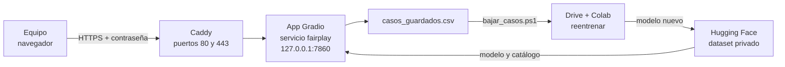

# Despliegue en OCI (Always Free)

La app queda publicada en una máquina virtual gratuita de Oracle Cloud, siempre encendida,
con HTTPS y protegida con usuario y contraseña del equipo.

| | |
|---|---|
| Máquina | VM.Standard.A1.Flex (ARM), Ubuntu 24.04. Basta con 1 OCPU y 6 GB |
| Dirección | `https://<IP-con-guiones>.sslip.io` (dominio gratis que apunta a la IP) |
| App | servicio `fairplay` (systemd), escucha solo en `127.0.0.1:7860` |
| HTTPS | Caddy, que pide y renueva solo el certificado de Let's Encrypt |
| Datos y modelo | se descargan del dataset privado de Hugging Face la primera vez |
| Casos marcados | `/opt/fairplay/casos/casos_guardados.csv` en la VM |



> La dirección IP, la contraseña del equipo y el token de Hugging Face **no** van en el repositorio, ni en issues o pull requests. Se comparten por el canal privado del equipo.

## Archivos

* `instalar.sh`: instala todo (paquetes, código, entorno de Python, servicio, HTTPS y firewall). Volver a correrlo **actualiza** la app a la última versión de la rama.
* `configurar_secretos.sh`: pide el token de Hugging Face y la contraseña del equipo y los guarda en `/etc/fairplay.env` (solo root puede leerlo). **Nunca** se suben al repositorio.
* `fairplay.service`: el servicio que mantiene la app encendida y la reinicia si falla.
* `Caddyfile`: HTTPS y redirección a la app.
* `bajar_casos.ps1` y `actualizar_modelo.ps1`: se corren desde Windows para reentrenar (ver más abajo).

## Pasos (una sola vez)

1. **En la consola de OCI**, crear la instancia (Ubuntu 24.04, forma Ampere *Always Free-eligible*, IP pública) y guardar la clave privada SSH.
2. **En la subred de la instancia** → *Security Lists* → *Add Ingress Rules*: origen `0.0.0.0/0`, TCP, puertos `80,443`.
3. **En la VM** (por SSH):

   ```bash
   git clone -b feat/clasificador-pares https://github.com/sergiorebolledo/sic-ia-clone-radar.git /tmp/fp
   sudo bash /tmp/fp/despliegue/oci/configurar_secretos.sh
   bash /tmp/fp/despliegue/oci/instalar.sh
   ```

La primera vez tarda unos 10 minutos (descarga ~630 MB del modelo y arma el TF-IDF).

Para comprobar que quedó bien: abrir `https://<IP-con-guiones>.sslip.io` en el navegador. Debe pedir usuario y contraseña y mostrar la app con el chip **Modelo A** (o **B**) arriba.

## Mantención

```bash
bash /opt/fairplay/repo/despliegue/oci/instalar.sh     # actualizar a la última versión
journalctl -u fairplay -f                              # ver los registros de la app
sudo systemctl restart fairplay                        # reiniciar la app
sudo bash /opt/fairplay/repo/despliegue/oci/configurar_secretos.sh   # cambiar token o contraseña
```

## Ciclo para reentrenar (desde Windows, en esta carpeta)

El servidor solo muestra la app; el entrenamiento sigue en Colab.

1. El equipo marca casos en la app publicada (no en la demo de Colab, que guarda en otro archivo).
2. Bajar los casos al computador:

   ```powershell
   .\bajar_casos.ps1 -Ip <IP>
   ```

   Deja `casos\casos_guardados_<fecha>.csv`. Subirlo a Drive como `MyDrive/fairplay/data/casos_guardados.csv`.
3. Correr `FairPlay_AI_Clasificador_Pares.ipynb` en Colab y subir la carpeta `modelo/` nueva al dataset de Hugging Face.
4. Hacer que el servidor use el modelo nuevo:

   ```powershell
   .\actualizar_modelo.ps1 -Ip <IP>
   ```

   Descarga el modelo, reinicia la app y dice si quedó con el Modelo A o B. Si el modelo nuevo no carga, vuelve solo al anterior.

Ambos usan la clave `~\.ssh\oci_fairplay.key`; otra ruta se indica con `-Clave`.

## Si algo falla

| Síntoma | Qué revisar |
|---|---|
| El navegador no conecta | Las reglas de ingreso 80 y 443 de la subred (paso 2) y `sudo systemctl status caddy`. |
| Error 502 | La app está partiendo o se cayó: `journalctl -u fairplay -n 50`. Tras un reinicio tarda cerca de un minuto. |
| La app abre sin las pestañas del modelo | No pudo descargar el modelo: revisar el token con `configurar_secretos.sh` y reiniciar. |
| No pide contraseña | Falta `FAIRPLAY_CLAVE` en `/etc/fairplay.env`: correr `configurar_secretos.sh`. |
| Aviso de certificado | Caddy todavía no obtiene el certificado: esperar un par de minutos y revisar `journalctl -u caddy -n 50`. |

## Cuidados

* OCI puede recuperar máquinas *Always Free* que pasan 7 días casi sin uso (CPU, red y memoria muy bajas).
* La forma A1 es gratis solo dentro del límite *Always Free*; no cambiarla a AMD o Intel.
* Si se filtra la contraseña del equipo, cambiarla con `configurar_secretos.sh`.
* Los casos marcados viven solo en la VM: bajarlos con `bajar_casos.ps1` de vez en cuando, como respaldo.
