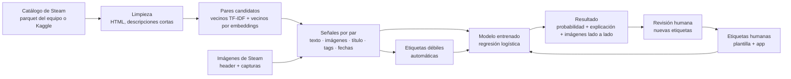
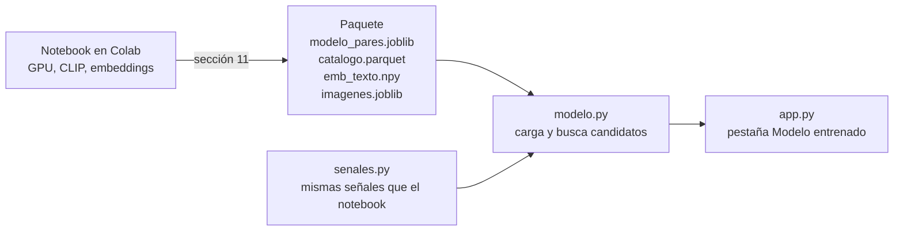

# Guía técnica de FairPlay AI

Esta guía explica **qué hace el sistema, cómo está construido y por qué se eligió cada pieza**. Está pensada para que cualquier integrante del equipo (o un evaluador) pueda entender el proyecto sin haber escrito el código.

---

## 1. Qué hace el sistema, en una frase

Dado un videojuego de Steam, FairPlay AI busca otros juegos que se le parecen en **descripción, imágenes, título y metadatos**, calcula una **probabilidad de que el par merezca revisión humana** y **explica** de dónde sale ese parecido.

> **Similitud no es plagio.** El sistema ordena candidatos para que una persona los revise. No acusa a nadie ni emite juicios legales.

---

## 2. Mapa del repositorio

| Ruta | Qué es |
|---|---|
| `FairPlay_AI_Clasificador_Pares.ipynb` | **Notebook principal.** Datos reales de Steam, señales por par, modelo entrenado y evaluado. |
| `FairPlay_AI_DBSCAN.ipynb` | Primer experimento con datos simulados (agrupamiento con DBSCAN). Se conserva como antecedente. |
| `Primera fase práctica/similitud.py` | Lógica de la línea base TF-IDF (sin interfaz). |
| `Primera fase práctica/senales.py` | Calcula las señales de un par de juegos, igual que el notebook, para que la app pueda usar el modelo. |
| `Primera fase práctica/modelo.py` | Carga el modelo entrenado (exportado por el notebook), busca candidatos y explica pares. |
| `Primera fase práctica/app.py` | App web en Gradio: línea base TF-IDF (buscar, comparar, texto nuevo), pestaña **Modelo entrenado** y registro de casos etiquetados. |
| `Primera fase práctica/requirements.txt` | Dependencias de la app, con versiones fijas. |
| `tests/` | Tests automáticos de `similitud.py` y `app.py`. |
| `.github/workflows/tests.yml` | Corre los tests en GitHub en cada push. |
| `requirements-dev.txt` | Dependencias para desarrollar (app + pytest). |
| `requirements-notebook.txt` | Dependencias del notebook si se corre fuera de Colab. |
| `docs/` | Esta guía. |
| `Documentos/` | Informe, pitch y hoja de trabajo del equipo. |

Carpetas que **no** se suben a GitHub (están en `.gitignore`): `data/` (datos de Steam), `casos/` (etiquetas del equipo), `modelo/` (el modelo exportado, que incluye el catálogo), los archivos de caché `*.joblib` / `*.parquet` y el material del curso con derechos reservados (`Documentos/Proyecto Final/`).

---

## 3. Flujo de datos



El ciclo de la derecha es importante: **cada par que el equipo etiqueta mejora el modelo** (sección 10 del notebook).

---

## 4. El stack y por qué se eligió cada pieza

| Herramienta | Para qué se usa | Por qué esta y no otra |
|---|---|---|
| **Python 3.12** | Lenguaje de todo el proyecto | Es la versión de Google Colab y la que soportan todas las librerías. Python 3.14 todavía da problemas con torch. |
| **pandas + pyarrow** | Tablas de juegos y pares; leer/escribir parquet | Estándar del curso. Parquet es mucho más rápido y liviano que CSV. |
| **scikit-learn** | TF-IDF, regresión logística, validación cruzada, métricas (y búsqueda de vecinos cuando no hay GPU) | Visto en clases; todo en una sola librería; modelos interpretables. |
| **torch** (en Colab) | Búsqueda de vecinos en la GPU | Con todo Steam (~138 mil juegos), buscar los vecinos con scikit-learn en la CPU tarda más de 15 minutos; en la GPU, segundos. Da exactamente los mismos vecinos. |
| **sentence-transformers** | Embeddings de texto (`paraphrase-multilingual-MiniLM-L12-v2`) y de imagen (CLIP `clip-ViT-B-32`) | Modelos preentrenados de Hugging Face (transfer learning). MiniLM es rápido y entiende varios idiomas; CLIP compara imágenes por contenido. |
| **imagehash** | Hash perceptual de imágenes (`phash`) | Detecta imágenes **casi idénticas** (assets reutilizados) de forma barata y fácil de explicar. Complementa a CLIP, que detecta imágenes *parecidas*. |
| **rapidfuzz** | Parecido entre títulos | Muy rápido y tolera palabras reordenadas ("Escape the Walls" vs "Walls Escape"). |
| **requests** | Descargar imágenes y consultar la API de la tienda de Steam | Simple y suficiente. |
| **kagglehub** | Descargar el dataset de Steam de Kaggle | Oficial de Kaggle; funciona directo en Colab. |
| **Gradio** | Interfaz web de la app | Visto en la clase 4; se despliega gratis en Hugging Face Spaces. |
| **pytest + GitHub Actions** | Tests automáticos | Detectan si un cambio rompe algo antes de presentarlo. Suman en "madurez del software" de la pauta. |

### Lo que se evaluó y se dejó fuera (a propósito)

| Opción | Por qué no |
|---|---|
| **SteamDB** como fuente de datos | Su FAQ prohíbe el scraping, incluso académico sin permiso, y prohíbe usar sus datos para entrenar IA. Se puede consultar **a mano** para documentar un caso, citándola. |
| FAISS u otra base vectorial | Con ~100 mil juegos, la búsqueda de scikit-learn alcanza. Sería complejidad sin beneficio. |
| MLflow / DVC | Útiles en proyectos largos; para 4 semanas es más costo que beneficio. |
| Un LLM que decida si hay copia | La pauta exige un modelo entrenado por el equipo, y delegar el juicio a un LLM contradice "similitud no es plagio". |
| Comparar código fuente (grafos de flujo de control) | No hay acceso legítimo al código de la mayoría de los juegos y no cabe en el plazo. Queda como trabajo futuro. |

---

## 5. Las señales, explicadas sin tecnicismos

Para cada par de juegos (A, B) se calculan estas señales. Todas valen entre 0 (nada parecido) y 1 (idéntico), salvo `log_dias`.

| Señal | Qué pregunta responde | Cómo se calcula |
|---|---|---|
| `tfidf_cos` | ¿Usan **las mismas palabras**? | TF-IDF da más peso a las palabras raras y menos a las comunes ("game", "play"). Luego se mide el ángulo entre los dos vectores (similitud coseno). |
| `emb_cos` | ¿Dicen **lo mismo** aunque con otras palabras? | Un modelo de lenguaje convierte cada descripción en un vector de significado. "Huye de los muros" y "escapa de las paredes" quedan cerca. |
| `img_cos` | ¿Sus imágenes **se ven parecidas**? | CLIP convierte cada imagen (header y capturas) en un vector. Se comparan todas contra todas y se guarda el par más parecido. |
| `phash_sim` | ¿Comparten una imagen **casi idéntica**? | El hash perceptual es una "huella" de 64 bits de la imagen reducida. Si dos huellas difieren en pocos bits, las imágenes son prácticamente la misma. |
| `titulo_sim` | ¿Los **nombres** se parecen? | Compara las palabras de ambos títulos sin importar el orden. |
| `tags_jaccard` | ¿Comparten **géneros y tags**? | Tags en común ÷ tags totales. |
| `log_dias` | ¿Salieron **cerca en el tiempo**? | Logaritmo de los días entre lanzamientos (así 10 vs 20 días pesa más que 1000 vs 1010). |
| `mismo_dev` | ¿Son del **mismo estudio**? | 1 si el desarrollador coincide. Una serie propia no es un clon. |

**¿Por qué tantas señales?** Porque cada una falla en casos distintos. Un clon puede reescribir la descripción (TF-IDF falla, embeddings no) o cambiar el texto pero reutilizar capturas (el texto falla, `phash_sim` no). Dos juegos del mismo género comparten vocabulario sin ser copias (TF-IDF da falsa alarma; las imágenes y el título ayudan a descartarlo).

---

## 6. El modelo

### 6.1 La pregunta que responde

> Dado un par de juegos, **¿merece revisión humana?** (sí = 1, no = 0)

Es un problema de **clasificación binaria sobre pares**, no sobre juegos individuales.

### 6.2 De dónde salen las etiquetas

| Tipo | Origen | Ventaja | Problema |
|---|---|---|---|
| **Humanas** | `Plantilla_registro_coincidencias.xlsx`, los casos guardados en la app y el **lote de la sección 10** (`data/lote_etiquetado.xlsx`, ver [Guía de etiquetado](GUIA_ETIQUETADO.md)) | Son confiables | Son pocas y cuesta conseguirlas |
| **Débiles** (automáticas) | Positivo: descripción casi idéntica (`tfidf_cos ≥ 0.90`) y con el mismo significado (`emb_cos ≥ 0.80`) entre estudios distintos. Negativo: mismo tema pero texto distinto (`0.20–0.60`). Ambas descripciones deben tener al menos 20 términos TF-IDF | Hay miles, gratis | Son aproximadas y **se definen con el texto** |

### 6.3 Por qué hay dos modelos

* **Modelo A (sin texto).** Se entrena con las etiquetas débiles **sin ver ninguna señal de texto**. Si las viera, aprendería la regla "texto idéntico = clon", que ya sabemos y que no sirve cuando el clon reescribe la descripción. Sin texto, el modelo tiene que descubrir qué *otras* señales (imágenes, título, tags, fechas) acompañan a un clon.
* **Modelo B (todas las señales).** Se entrena **solo con etiquetas humanas**. Se activa cuando hay al menos 10 pares de cada clase.

Ambos son **regresiones logísticas**: cada señal recibe un peso, y ese peso se puede mostrar y explicar ("la imagen idéntica empujó la probabilidad hacia arriba"). Se compara con *gradient boosting* para ver si un modelo más flexible gana algo.

### 6.4 Cómo se evalúa sin hacer trampa

* **Validación cruzada por grupos (`GroupKFold`).** Los juegos de una misma "familia" de clones quedan todos en el mismo grupo. Así el modelo nunca se evalúa con un clon cuya familia ya vio al entrenar.
* **La evaluación que vale para el informe es la de las etiquetas humanas** (sección 7 del notebook), comparada con la **línea base**: usar solo `tfidf_cos`, que es lo que hace la app hoy.

### 6.5 Cómo llega el modelo a la app

El notebook hace el trabajo pesado (embeddings de texto con un modelo de lenguaje, descarga de imágenes y CLIP) y al final **exporta un paquete** con todo ya calculado. La app solo carga ese paquete, así que corre en cualquier computador o en Hugging Face Spaces gratis, sin GPU.



**Regla importante:** las señales se calculan en dos lugares (el notebook y `senales.py`). Deben hacerlo exactamente igual, porque el modelo aprendió con los números del notebook. Si se cambia el cálculo de una señal, hay que cambiarla en ambos lados y volver a entrenar. Los tests de `tests/test_senales.py` fijan el comportamiento esperado.

**Limitación:** la app solo busca juegos que estén en el catálogo del paquete. Para un juego nuevo hay que agregarlo al catálogo y volver a exportar desde el notebook.

### 6.6 Las métricas

| Métrica | Qué significa | Por qué se usa |
|---|---|---|
| **PR-AUC** (precisión promedio) | Qué tan bien quedan los pares positivos arriba del ranking, en todos los umbrales | Es la adecuada cuando los positivos son pocos. La exactitud (accuracy) engaña: decir "nunca es clon" acertaría casi siempre. |
| **ROC-AUC** | Probabilidad de que un positivo al azar quede por encima de un negativo al azar | Referencia estándar. |
| **Precisión@20** | De los 20 pares que el modelo pone primero, cuántos son realmente positivos | Es lo que vive la persona usuaria: revisa los primeros resultados. |

---

## 7. Cómo correr cada parte

### Notebook (recomendado en Google Colab)

1. Abrir `FairPlay_AI_Clasificador_Pares.ipynb` en Colab (botón "Open in Colab").
2. *Entorno de ejecución → Cambiar tipo → GPU T4*.
3. Subir a Google Drive, en `MyDrive/fairplay/data/`: el parquet, la plantilla y `casos_guardados.csv` (si existe).
4. En la celda de configuración: `USAR_DRIVE = True`.
5. *Entorno de ejecución → Ejecutar todo*.

Opciones útiles de la configuración:

| Opción | Cuándo cambiarla |
|---|---|
| `FUENTE = "kaggle"` | Para usar el dataset completo de Kaggle en vez del parquet del equipo. Trae capturas. |
| `CAPTURAS_API = True` | Si el catálogo no trae capturas. Es lento (~1,5 s por juego), por eso viene apagado. |
| `N_CAPTURAS` | Más capturas = mejor detección de assets reutilizados, pero más descargas. |
| `MAX_JUEGOS` | Sin GPU, bajarlo a ~20000. |

Lo que ya se calculó queda guardado en `MyDrive/fairplay/salidas/` (catálogo de Kaggle reducido, embeddings, vecinos, imágenes procesadas) y **no se recalcula** en la siguiente corrida mientras el catálogo no cambie. Por eso la primera corrida es la lenta (descarga del dataset, embeddings e imágenes) y las siguientes son mucho más rápidas.

**Si la app dice que el modelo se entrenó con otra versión de scikit-learn:** el paquete se exportó con una versión distinta a la de `Primera fase práctica/requirements.txt`. La primera celda del notebook instala la misma versión que la app; vuelve a correr el notebook y copia el paquete nuevo. Un modelo guardado con una versión no siempre funciona con otra (el error típico es `'SimpleImputer' object has no attribute '_fill_dtype'`).

**Si Colab dice que se acabó la RAM:** *Entorno de ejecución → Reiniciar sesión* y volver a *Ejecutar todo*. No relances *Ejecutar todo* sobre una sesión que ya corrió el notebook: los datos viejos siguen en memoria y se duplican.

### App en local

```bash
pip install -r "Primera fase práctica/requirements.txt"
cd "Primera fase práctica"
python app.py
```

Necesita el parquet en `Primera fase práctica/data/juegos_texto_en.parquet`.

Para activar la pestaña **Modelo entrenado**, copiar la carpeta `salidas/paquete_app` que genera el notebook (sección 11) a `Primera fase práctica/modelo/`. En esa pestaña:

1. Se escribe el título de un juego del catálogo y se pulsa *Buscar candidatos*.
2. La tabla muestra los candidatos ordenados por **probabilidad de revisar** y el valor de cada señal; la galería muestra sus imágenes de Steam.
3. En *Explicar un candidato* se elige uno: aparece qué señales subieron o bajaron la probabilidad y las dos imágenes lado a lado.
4. En *Guardar este candidato como caso* se etiqueta, y esa etiqueta vuelve al notebook como dato humano.

### Tests

```bash
pip install -r requirements-dev.txt
pytest
```

Deben pasar todos. En GitHub se corren solos en cada push (pestaña **Actions**). En un fork, la primera vez hay que habilitarlos en *Actions → I understand my workflows, go ahead and enable them*.

---

## 8. Publicar la app en Hugging Face Spaces

Así la demo tiene un enlace permanente, sin depender de que alguien tenga su computador encendido.

1. **Subir los datos a un dataset privado.** En huggingface.co: *New → Dataset*, marcarlo **privado**, y subir `juegos_texto_en.parquet`. Para la pestaña del modelo, subir también los cuatro archivos de `salidas/paquete_app` dentro de una carpeta `modelo/` del dataset.
2. **Crear un token de lectura.** *Settings → Access Tokens → New token* (tipo *Read*).
3. **Crear el Space.** *New → Space*, SDK **Gradio**.
4. **Subir al Space** los archivos `app.py`, `similitud.py`, `senales.py`, `modelo.py` y `requirements.txt` de `Primera fase práctica/`.
5. **Configurar el Space** en *Settings → Variables and secrets*:
   * Variable `FAIRPLAY_HF_DATASET` = `usuario/nombre-del-dataset`
   * Secreto `HF_TOKEN` = el token del paso 2
6. El Space instala las dependencias y arranca. La app descarga el parquet y el modelo al iniciar (funciones `resolver_datos` y `cargar_modelo` en `app.py`).

**Ojo:** en Spaces gratuitos el disco se borra al reiniciar, así que los casos guardados en la app se pierden. Para etiquetar, usen la app en local o descarguen el CSV antes de reiniciar.

---

## 9. Datos: qué se puede usar y qué no

| Fuente | ¿Se puede? | Nota |
|---|---|---|
| API de la tienda de Steam (`store.steampowered.com/api/appdetails`) | Sí | Pública. Ir lento: el notebook espera 1,5 s entre consultas y guarda cada respuesta. |
| Imágenes del CDN de Steam (header y capturas) | Sí, para análisis | No redistribuirlas en el repositorio. |
| Dataset de Steam en Kaggle (FronkonGames) | Sí | Revisar su licencia antes de publicar resultados derivados. |
| SteamSpy API | Sí | Tags y estimaciones de jugadores. |
| SteamDB | **Solo consulta manual** | Prohíbe scraping y entrenar IA con sus datos. |

**Privacidad y publicación:** los datos de Steam y las etiquetas del equipo **no** se suben al repositorio público. Tampoco el material del curso con derechos reservados.

---

## 10. Trabajo en equipo con Git

El repositorio del equipo es `lina-cc/sic-ia-clone-radar`. Cada integrante trabaja en su **fork** y propone cambios con **pull requests**.

```bash
# Una sola vez: conectar el repo del equipo como "upstream"
git remote add upstream https://github.com/lina-cc/sic-ia-clone-radar.git

# Antes de empezar algo nuevo: traer lo último del equipo
git switch main
git pull upstream main

# Trabajar en una rama
git switch -c feat/lo-que-voy-a-hacer
# ...cambios...
pytest
git add <archivos>
git commit -m "feat: descripción corta del cambio"
git push -u origin feat/lo-que-voy-a-hacer
# Luego, en GitHub: "Compare & pull request" hacia lina-cc/main
```

Convención de mensajes: `feat:` (algo nuevo), `fix:` (corrección), `docs:` (documentación), `test:` (tests).

---

## 11. Limitaciones conocidas

* Las etiquetas débiles salen del texto: miden "texto casi idéntico", no "copia".
* El TF-IDF está pensado para inglés. Las descripciones en otros idiomas quedan casi vacías y pueden dar `tfidf_cos = 1` entre textos distintos. En la primera corrida con todo Steam eso volvió falsa la mitad de los positivos débiles; por eso ahora se exige además `emb_cos ≥ 0.80` y un mínimo de términos (`MIN_TERMINOS`).
* El Modelo A se entrena solo con pares débiles que tienen imagen. En una corrida, a los negativos les faltaba imagen mucho más que a los positivos (87 % contra 14 %), y el modelo aprendía la regla falsa "sin imagen = no es copia".
* Se usan pocas imágenes por juego (header y unas pocas capturas). No se analizan videos ni jugabilidad.
* En la app, los juegos que no se usaron al entrenar tienen solo la imagen de cabecera (`CABECERAS_APP`). Con una sola imagen, `img_cos` tiende a salir algo más bajo que con header y capturas.
* Los juegos con descripción muy corta se descartan.
* La validación por grupos agrupa por familias de positivos; un juego puede aparecer en pares negativos de distintos grupos.
* Solo Steam. Roblox, itch.io y otras tiendas quedan como trabajo futuro.

---

## 12. Glosario

| Término | Significado |
|---|---|
| **Par candidato** | Dos juegos que vale la pena comparar porque alguno aparece entre los más cercanos del otro. |
| **Embedding** | Vector de números que resume el significado de un texto o el contenido de una imagen. |
| **Similitud coseno** | Medida de parecido entre dos vectores: 1 = misma dirección, 0 = nada en común. |
| **TF-IDF** | Forma de representar textos que pesa más las palabras raras y menos las comunes. |
| **CLIP** | Modelo preentrenado que convierte imágenes (y textos) en embeddings comparables. |
| **Hash perceptual** | Huella corta de una imagen que cambia poco si la imagen cambia poco. |
| **Transfer learning** | Usar un modelo ya entrenado por otros, en vez de entrenar uno desde cero. |
| **Etiqueta débil** | Etiqueta generada automáticamente con una regla; útil pero imperfecta. |
| **Validación cruzada** | Entrenar y evaluar varias veces con distintas particiones para medir qué tan bien generaliza. |
| **PR-AUC** | Área bajo la curva precisión–recall; resume la calidad del ranking cuando los positivos son pocos. |
| **Fork** | Copia de un repositorio en tu cuenta de GitHub, para trabajar sin tocar el original. |
| **Pull request** | Propuesta de incorporar los cambios de una rama al repositorio del equipo. |
