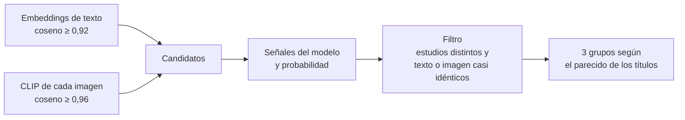

# Pares casi idénticos entre estudios distintos

**Responsable:** Sergio · **Estado:** ✅ Primera corrida (noviembre de 2026)

## Pregunta

¿Qué pares del catálogo comparten la descripción o una imagen casi idéntica, aunque los publiquen estudios con nombres distintos?

## Por qué podría servir

Revisando pares al azar o leyendo reseñas aparecen pocas «Posible copia». Reutilizar material (las mismas capturas o la misma descripción con otro nombre) es el caso más claro para un especialista, así que esta búsqueda es una fuente de candidatos para etiquetar.

## Datos

El paquete del modelo que usa la app: catálogo de Steam, embeddings de texto y vectores CLIP de las imágenes (portada y hasta 3 capturas). No descarga nada nuevo.

## Cómo correrlo

Desde la raíz del repositorio, con el paquete en `Primera fase práctica/modelo/` y el entorno de la app:

```bash
python experimentos/casi_identicos/buscar.py      # unos 6 minutos sin GPU
python experimentos/casi_identicos/lista.py       # arma el Excel para etiquetar
```

Los resultados quedan en `salidas/`, que no se sube al repositorio.

## Cómo funciona



1. **Vecinos por texto:** para cada juego, sus 4 descripciones más parecidas por significado.
2. **Vecinos por imagen:** para cada imagen, las 4 más parecidas de otros juegos.
3. Calcula las señales y la probabilidad del Modelo A para cada par.
4. Se queda con los pares de **estudios claramente distintos** (nombre distinto y poco parecido) con **texto casi idéntico** (descripciones de 300 caracteres o más) o **imagen casi idéntica** (hash perceptual ≥ 0,9).
5. Los agrupa por el parecido de los títulos: con títulos casi iguales suele ser la misma obra (demo, versión VR, cambio de editor).
6. Cada juego aparece en 2 pares como máximo.

## Resultados

| Paso | Pares |
|---|---|
| Candidatos (texto o imagen muy parecidos) | 5.388 |
| · por texto | 4.874 |
| · por imagen | 895 |
| De estudios claramente distintos | 405 |
| Con texto o imagen casi idénticos, tras el límite por juego | 127 |
| · Grupo 1 · Mirar con atención | 76 |
| · Grupo 2 · Misma plantilla o serie | 12 |
| · Grupo 3 · Probablemente la misma obra | 39 |

El 86 % de los candidatos son del **mismo estudio** (secuelas, versiones, plantillas propias).

**Línea base de comparación:** los pares que encuentra el notebook de reseñas.

| Fuente de candidatos | Probabilidad mediana del Modelo A |
|---|---|
| Grupo 1 de esta búsqueda (76 pares) | 0,78 |
| Pares que los jugadores llaman «clon» en sus reseñas (75 pares) | 0,17 |

## Qué aprendimos

- **El modelo reconoce el material reutilizado.** 63 de los 76 pares del grupo 1 superan 0,5.
- **Hay pares parecidos solo por imagen que nunca son candidatos en la app:** la búsqueda encontró 18 pares con la misma imagen y texto distinto. La app arma los candidatos solo con el texto. Ver [`vecinos_imagen/`](../vecinos_imagen/).
- **Nombres de estudio distintos no son personas distintas.** Varios pares del grupo 1 son el mismo autor con dos nombres. `mismo_dev` exige el nombre exacto; un parecido difuso entre nombres evitaría esas falsas alarmas.
- **Hay familias enormes** del mismo juego republicado decenas de veces con otro nombre. Por eso el límite por juego.

## Límites

- Son **candidatos sin revisar**: no se nombran en el repositorio ni se tratan como copias.
- Solo mira la portada y hasta 3 capturas por juego, y solo los juegos que tienen imágenes en el paquete.
- Los pares de texto idéntico se parecen a las etiquetas automáticas del Modelo A. Si casi todas las «Posible copia» humanas salen de aquí, el Modelo B aprendería sobre todo «texto o imagen igual = copia». Conviene mezclarlas con las de la cola y las reseñas.
